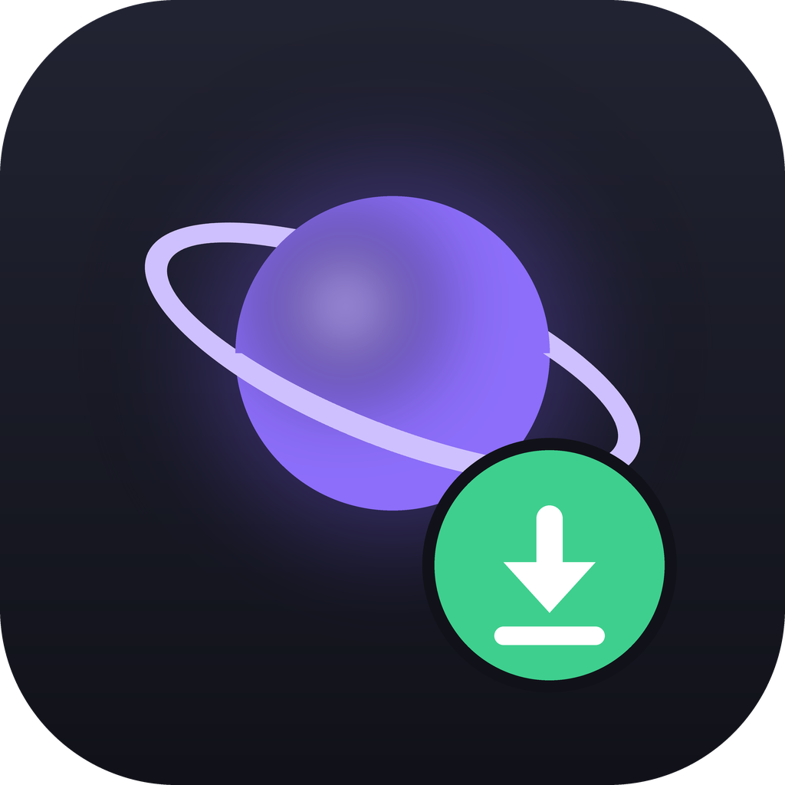
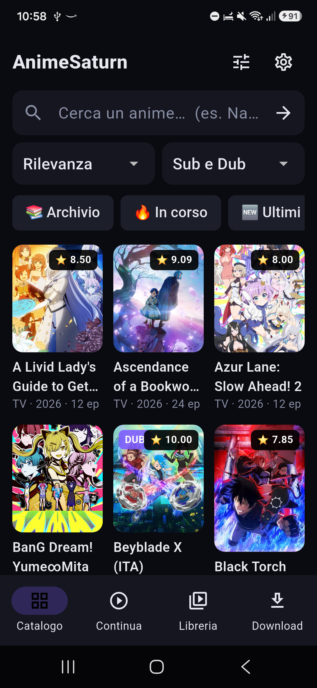
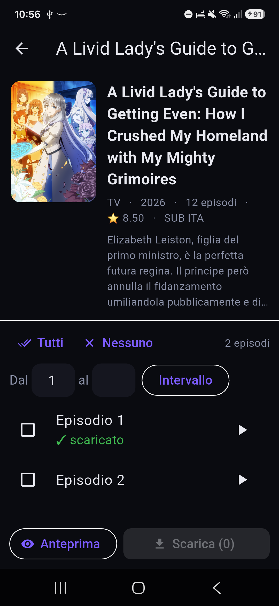
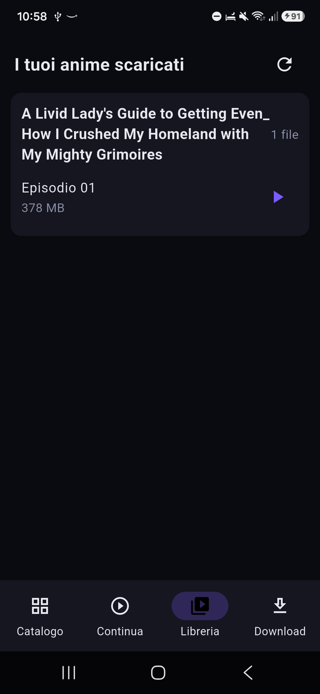
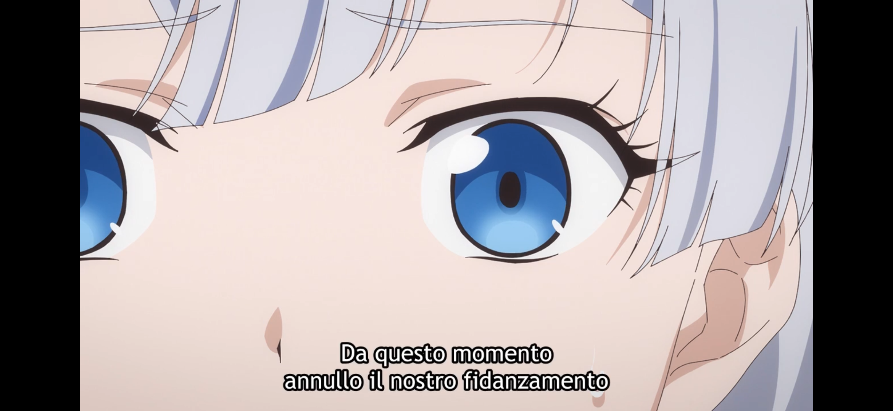
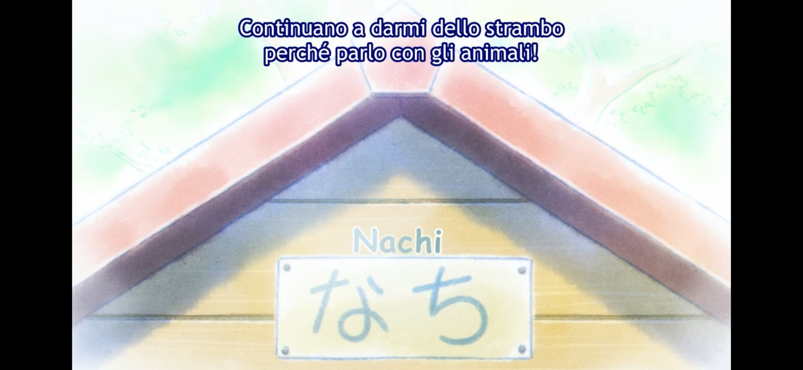

<p align="center">
  
</p>

<h1 align="center">AnimeSaturn — App Android</h1>

<p align="center">
  Guarda e scarica anime in italiano dal telefono, da
  <b>AnimeSaturn</b> e <b>AnimeUnity</b>: all'avvio scegli il portale.<br>
  Streaming integrato, download offline e ripresa da dove eri rimasto.
</p>

<p align="center">
  <sub>
    L'app si chiama ancora AnimeSaturn, come l'icona sul telefono, ma i portali che
    legge sono due. Lo stesso programma esiste anche
    <a href="https://github.com/piciolo/AnimeSaturn-AnimeUnity-Downloader">per Windows</a>,
    e i due si scambiano preferiti e punto di ripresa.
  </sub>
</p>

<p align="center">
  <a href="https://github.com/piciolo/animesaturn-apk-/releases/latest">
    
  </a>
  
</p>

---

## 📸 Com'è fatta

<p align="center">
  
  &nbsp;
  
  &nbsp;
  
</p>

<p align="center">
  &nbsp;
</p>

## ✨ Cosa puoi fare

- **Due portali, uno alla volta.** All'avvio scegli dove guardare — **AnimeSaturn** o
  **AnimeUnity**. Puoi ricordare la scelta e cambiarla dalle Impostazioni. Catalogo,
  ricerca, preferiti e *continua a guardare* mostrano il portale scelto; le voci
  dell'altro **non vengono spostate né cancellate** e tornano in elenco appena ci torni.
- **Se un portale non riesce a servire un episodio, l'app lo cerca sull'altro** per
  titolo e riproduce quello, senza chiedere nulla.
- **Cerca** un anime e ottieni i suggerimenti mentre scrivi.
- **Sfoglia** il catalogo: *Archivio*, *In corso*, *Ultimi aggiunti*, con **filtri**
  per genere, tipo, stato, stagione, lingua, anno e **Sub/Dub**.
- **Guarda in streaming** dentro l'app: schermo intero, **episodio successivo** e
  passaggio automatico alla puntata dopo.
- **Riprendi da dove eri rimasto** — l'app ricorda episodio e minuto, sia in
  streaming sia sui file scaricati.
- **Scarica gli episodi** (singoli, tutti o un intervallo) e guardali **offline**:
  coda con velocità, download simultanei regolabili, pausa e **ripresa** se
  l'interruzione ti lascia a metà.
- **Libreria** con tutto ciò che hai scaricato, pronta da riprodurre.
- Se un portale **cambia indirizzo**, l'app se ne accorge e si aggiorna da sola:
  l'elenco dei domini è pubblicato qui accanto agli APK, quindi un trasloco del sito
  non richiede una nuova versione. Se proprio serve, puoi inserirlo a mano dalle
  Impostazioni.

## ⬇️ Come si installa

1. Apri le **[Releases](https://github.com/piciolo/animesaturn-apk-/releases/latest)**
   e scarica l'APK:
   - **`AnimeSaturn-*-arm64-v8a.apk`** → praticamente tutti i telefoni moderni;
   - `armeabi-v7a` → solo telefoni molto vecchi a 32 bit;
   - **`AnimeSaturn-*-universal.apk`** → se non sai quale scegliere o lo installi
     su **Fire TV / TV box**: va su tutto (più grande, ma a prova di errore).
2. Apri il file scaricato sul telefono.
3. Android chiederà di consentire l'installazione da **origini sconosciute**:
   acconsenti e completa. Fine.

> Non arrivando dal Play Store, è normale che il telefono mostri un avviso: è la
> procedura standard per le app installate manualmente (*sideload*).

## 📺 Su Fire TV / Fire Stick

Il Fire Stick usa Android, quindi l'app si installa via *sideload*. Usa l'APK
**`universal`**. In breve:

1. Installa **Downloader** dall'Amazon Appstore e, in *Impostazioni → I miei
   Fire TV → Opzioni sviluppatore → Installa app sconosciute*, abilita Downloader.
2. In Downloader apri la pagina delle **Releases** e scarica l'APK `universal`, poi
   installalo.
3. Installa anche **Mouse Toggle for Fire TV**: aggiunge un **cursore** comandabile
   col telecomando — serve perché l'app è nata per il tocco e la navigazione a
   frecce da sola è scomoda. (In alternativa: un mouse Bluetooth.)

> Il video va benissimo a schermo intero; è solo lo spostarsi nei menu col
> telecomando che richiede il cursore.


## 🔄 Aggiornamenti automatici (Obtainium)

Non arrivando da uno store, l'app non si aggiorna da sola. Con **Obtainium** sì:

1. Installa [Obtainium](https://github.com/ImranR98/Obtainium/releases/latest).
2. Tocca **Aggiungi app** e incolla questo indirizzo:
   ```
   https://github.com/piciolo/animesaturn-apk-
   ```
3. Scegli l'APK adatto al tuo dispositivo (vedi la tabella sopra) e conferma.

Da lì in poi riceverai ogni nuova versione come da uno store.

## 📱 Requisiti

- Android **7.0** o superiore
- Spazio libero per gli episodi che scarichi (indicativamente 300–500 MB l'uno)

## 💡 Consigli

- In orizzontale il video usa tutta l'altezza dello schermo; con il pulsante
  **Riempi** puoi allargarlo a tutto schermo (ritagliando i bordi).
- Se il catalogo non carica, apri **Impostazioni → Verifica ora**: l'app cerca da
  sola l'indirizzo aggiornato del portale.
- Attiva le **notifiche** se vuoi vedere l'avanzamento dei download.

## ⚠️ Note

App **non ufficiale**, non affiliata ad AnimeSaturn né ad AnimeUnity. Distribuita
per **uso personale**: rispetta le leggi sul diritto d'autore e i termini di servizio
dei siti, e guarda o scarica solo contenuti per cui hai i relativi diritti.
Nessuna garanzia: usala a tuo rischio.

Attribuzioni e licenze dei componenti di terze parti: vedi **[NOTICE.md](NOTICE.md)**.
